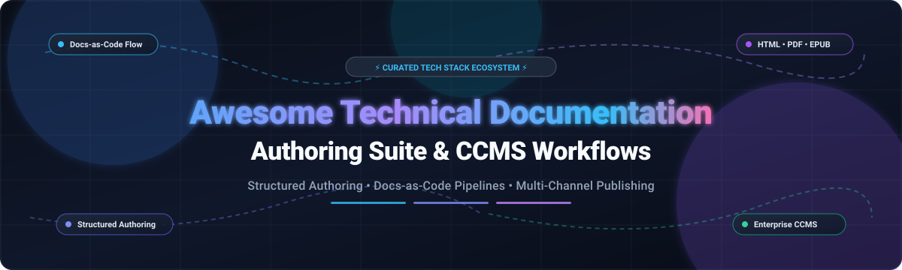

  

# 📚 Awesome Technical Documentation Authoring Suite

  
  
  
  
  
  

---

## 🎯 Executive Overview & SEO Taxonomy

> A curated directory of **Technical Documentation Authoring Suites**, **Docs-as-Code Workflows**, **Enterprise Component Content Management Systems (CCMS)**, and **Multi-Format Single-Source Publishing Engines**.

Technical documentation authoring suites go significantly beyond basic Markdown text editors. They provide comprehensive structured authoring environments, automated content reuse (snippets, conditionals, variables), enterprise version control, granular translation workflows, and automated multi-format publishing pipelines capable of generating static HTML websites, responsive portals, print-ready PDFs, EPUBs, and man pages from a unified single source of truth.

### 🔍 Quick Keyword Index
`Docs-as-Code` • `Technical Writing` • `Component Content Management System (CCMS)` • `DITA XML` • `DocBook` • `AsciiDoc` • `reStructuredText` • `Markdown++` • `Single-Source Publishing` • `Developer Portals` • `API Documentation` • `Static Site Generators (SSG)`

---

## 📑 Table of Contents

- [🌐 Sector Overview & Market Dynamics](#-sector-overview--market-dynamics)
- [🏢 SaaS & Hosted CCMS Platforms](#-saas--hosted-ccms-platforms)
  - [📊 SaaS Pricing & Valuation Comparison Table](#-saas-pricing--valuation-comparison-table)
  - [🔎 In-Depth SaaS Product Profiles](#-in-depth-saas-product-profiles)
- [💻 Open-Source Documentation Generators & Authoring Suites](#-open-source-documentation-generators--authoring-suites)
  - [⭐ Open-Source Leaderboard (Sorted by GitHub Stars)](#-open-source-leaderboard-sorted-by-github-stars)
  - [📖 Comprehensive Open-Source Suite Profiles](#-comprehensive-open-source-suite-profiles)
- [🧩 Architectural Comparison: Docs-as-Code vs. Enterprise CCMS](#-architectural-comparison-docs-as-code-vs-enterprise-ccms)
- [🤝 How to Contribute](#-how-to-contribute)
- [📈 Star History](#-star-history)
- [💖 Support & Community](#-support--community)
- [⚖️ Disclaimer](#-disclaimer)

---

## 🌐 Sector Overview & Market Dynamics

The global market for **Technical Documentation Software & Component Content Management Systems (CCMS)** is estimated at approximately **$2.8 billion to $4.5 billion**, projected to expand to over **$9.5 billion by 2033** at an estimated compound annual growth rate (**CAGR of 9.2% – 10.8%**). 

The sector is **moderately fragmented** rather than a winner-take-all monopoly. The industry is fundamentally bifurcated into two distinct operational paradigms:
1. **Regulated Enterprise CCMS (XML/DITA/DocBook)**: Highly specialized, compliance-driven authoring platforms (dominated by Adobe, MadCap Software, and Paligo) catering to manufacturing, aerospace, healthcare, and enterprise hardware where strict regulatory audits, component reuse, and localization are non-negotiable.
2. **Modern Developer Docs-as-Code (Git/Markdown/MDX/SSG)**: Fast-growing, product-led platforms and open-source frameworks (led by Mintlify, GitBook, Docusaurus, and Sphinx) catering to software engineering teams, API ecosystems, and cloud SaaS providers prioritizing Git version control, CI/CD publishing automation, and developer experience.

---

## 🏢 SaaS & Hosted CCMS Platforms

Commercial SaaS and hosted authoring platforms streamline infrastructure management, collaboration, localization, and enterprise compliance.

### 📊 SaaS Pricing & Valuation Comparison Table

The following table summarizes top commercial platforms, sorted by **Company Size / Valuation (Descending)**:

| # | 🏢 Platform | 🌟 Key Focus & Core Strengths | 💰 Company Valuation / Revenue | 🏷️ Specific Starting Pricing | 🎁 Free Tier / Trial Limits |
|---|---|---|---|---|---|
| **1** | **[Adobe FrameMaker](https://www.adobe.com/products/framemaker.html)** | Enterprise XML/DITA authoring, long-form structured technical manuals & PDF output | **~$220B Valuation** *(NASDAQ: ADBE, $21.4B Annual Revenue)* | **$29.99 / user / month** *(annual commitment prepaid or monthly; enterprise via Adobe VIP)* | **30-day free trial** with full feature access and export capabilities; no credit card required; no forever-free plan |
| **2** | **[Mintlify](https://mintlify.com/)** | Modern AI-native developer documentation, interactive API playground, and Git sync | **$500M Valuation** *($45M Series B led by a16z, ~$10M+ ARR)* | **$250 / month** *(billed annually for Pro tier; includes 5 editors & preview deployments)* | **Free Forever plan**: 1 editor seat, 1 project, custom domain hosting, Git sync, no AI assistant; 14-day Pro trial with AI credits included |
| **3** | **[MadCap Flare](https://www.madcapsoftware.com/products/flare/)** | Enterprise single-source multi-channel publishing, topic-based XML, and translation | **~$200M Valuation** *(Battery Ventures majority buyout, ~$40M–$60M ARR)* | **$3,150 / author / year** *(equivalent to $262.50 / author / month billed annually)* | **30-day free trial** with full feature set; all generated outputs (HTML5/PDF) contain scrambled test words and watermarks; no forever-free tier |
| **4** | **[GitBook](https://www.gitbook.com/)** | Knowledge management, developer docs, bi-directional GitHub/GitLab sync, and AI search | **~$150M Valuation** *(Bootstrapped & Seed-backed, profitable, ~$15M+ ARR)* | **$65 / site / month** *(+$12/member/month billed annually for Essential tier)* | **Free Forever plan**: 1 user, default `*.gitbook.io` subdomain, public docs, GitHub/GitLab sync; no custom domains or visitor authentication |
| **5** | **[Paligo](https://paligo.net/)** | Cloud-native Component Content Management System (CCMS), structured reuse, and multi-channel | **$116M Valuation** *($29M growth investment led by GRO Capital, ~$11.3M ARR)* | **$400 / month** *($4,800/yr to $15,000/yr baseline business tier for 2 author seats)* | **14 to 30-day guided evaluation sandbox** *(Proof-of-Concept demo granted via sales team with restricted test seats); no self-serve forever-free tier* |
| **6** | **[Heretto](https://heretto.com/)** | Cloud enterprise DITA CCMS, knowledge ops, component reuse, and customer portal delivery | **~$50M Valuation** *($23.2M venture capital led by Grand Oaks Capital, ~$5M–$6M ARR)* | **$150 / author / month** *($1,800 / author / year billed annually for entry author tier)* | **14-day guided proof-of-concept sandbox** upon sales qualification with preloaded sample DITA repository; no self-serve forever-free tier |
| **7** | **[Document360](https://document360.com/)** | Knowledge base platform, category manager, technical manuals, and AI reader assistant | **~$40M Valuation** *(Bootstrapped by Kovai.co, $10M+ ARR)* | **$149 / project / month** *(Standard/Professional tier billed annually; 2 team seats, 1 workspace)* | **14-day free trial** with full Pro feature set, 1 workspace, no credit card required; limited forever-free plan for up to 50 public articles |
| **8** | **[ReadMe](https://readme.com/)** | Developer documentation, interactive OpenAPI / Swagger exploration, and metrics | **~$35M Valuation** *($10.3M venture capital from Accel & Bessemer, ~$8M ARR)* | **$250 / project / month** *(Pro plan billed annually; includes 5 admin seats & custom CSS)* | **Free Forever Starter plan**: 1 admin, 1 project, interactive API reference generator, standard markdown editor, `*.readme.io` subdomain; 14-day Pro trial |
| **9** | **[ClickHelp](https://clickhelp.com/)** | Cloud-based authoring and hosting for software documentation, reporting, and translation | **~$15M Valuation** *(Privately held, profitable independent vendor, ~$3M–$5M ARR)* | **$185 / month** *(Starter tier billed annually; includes 2 author seats, 500 topics, 5 GB storage)* | **30-day free trial** with unrestricted access to all authoring, branding, and multi-format export tools for 2 temporary authors; no forever-free tier |

---

### 🔎 In-Depth SaaS Product Profiles

#### 1. [Adobe FrameMaker](https://www.adobe.com/products/framemaker.html) 👑
- **Overview**: The long-standing enterprise benchmark for authoring and publishing large technical documentation libraries. Full native support for DITA (1.2 and 1.3), DocBook, XML, and unstructured content.
- **Strengths**: Unrivaled typographic control for print-ready PDF generation; native integration with Adobe Experience Manager (AEM) Guides CCMS; robust handling of 1,000+ page technical manuals.
- **Ideal For**: Aerospace, automotive, defense, and heavy equipment manufacturers with rigorous compliance mandates.

#### 2. [Mintlify](https://mintlify.com/) ⚡
- **Overview**: The premier AI-native documentation platform engineered specifically for modern software and API-first businesses.
- **Strengths**: Out-of-the-box interactive API playground, automated code snippet testing, bi-directional Git synchronization, and built-in AI search assistants.
- **Ideal For**: Fast-scaling startups, API providers, and developer relations teams seeking state-of-the-art developer UX.

#### 3. [MadCap Flare](https://www.madcapsoftware.com/products/flare/) 📑
- **Overview**: The gold standard for multi-channel technical authoring. Flare allows technical writers to single-source content across web portals, responsive HTML5, PDFs, and EPUBs with granular condition tags and snippet variables.
- **Strengths**: Deep single-sourcing capabilities; advanced micro-content management; tight integration with MadCap Central for cloud collaboration and translation management.
- **Ideal For**: Dedicated technical documentation teams managing complex multi-product release versions.

#### 4. [GitBook](https://www.gitbook.com/) 📖
- **Overview**: Collaborative documentation platform connecting developer workflows with product and non-technical stakeholders.
- **Strengths**: Effortless two-way synchronization with GitHub and GitLab repositories; intuitive Notion-style block editor; integrated MCP (Model Context Protocol) and AI chat.
- **Ideal For**: Engineering-led organizations looking to bridge the gap between developer Markdown files and executive/customer-facing documentation.

#### 5. [Paligo](https://paligo.net/) ☁️
- **Overview**: A leading cloud-native Component Content Management System (CCMS) that provides structured authoring in the cloud without requiring in-house XML infrastructure.
- **Strengths**: Component-level content reuse, release management, branch comparison, integrated translation workflow with major translation memory systems (TMS), and multi-channel publishing to Zendesk, Salesforce, HTML5, and PDF.
- **Ideal For**: Scaling global enterprises requiring translation into dozens of languages with zero desktop installation overhead.

#### 6. [Heretto](https://heretto.com/) 🏛️
- **Overview**: An enterprise-grade, cloud-based DITA CCMS and content operations platform designed to organize, create, and deploy product and service knowledge.
- **Strengths**: Strict DITA standard compliance, collaborative browser-based authoring, automated validation, and digital customer service portal syndication.
- **Ideal For**: Telecom, medical device, and software enterprises standardized on the OASIS DITA standard.

#### 7. [Document360](https://document360.com/) 🗂️
- **Overview**: Self-service knowledge base software tailored for customer support, internal SOPs, and product documentation.
- **Strengths**: Dual Markdown and WYSIWYG editors, category hierarchy management, versioning, private doc security, and Eddy AI search.
- **Ideal For**: Customer support operations and SaaS product teams building searchable help centers.

#### 8. [ReadMe](https://readme.com/) 🛠️
- **Overview**: Interactive developer hub platform focused on transforming static API documentation into dynamic developer portals.
- **Strengths**: Live API explorer with instant `curl` and multi-language SDK execution, API metrics and usage logging, and Markdown doc hosting.
- **Ideal For**: Developer tools, fintech APIs, and web service providers prioritizing developer conversion and onboarding.

#### 9. [ClickHelp](https://clickhelp.com/) 🌐
- **Overview**: Modern cloud-hosted authoring tool and portal publisher for technical writers.
- **Strengths**: Topic-based authoring, contextual help widgets, patent-pending automatic content migration from Microsoft Word and CHM, and built-in readability metrics.
- **Ideal For**: Teams migrating from legacy desktop help authoring tools (HATs) to a managed cloud environment.

---

## 💻 Open-Source Documentation Generators & Authoring Suites

Open-source authoring suites eliminate per-seat licensing costs (saving upwards of **$3,150+ per author/year**), prevent vendor lock-in, and integrate natively into Git-driven CI/CD build pipelines.

### ⭐ Open-Source Leaderboard (Sorted by GitHub Stars)

Below is the definitive ranking of open-source documentation generators, static authoring engines, and structured publishing toolchains, sorted by **GitHub Star Count (Descending)**:

| # | 💻 Project Name | 🏷️ Stargazers Badge | 🛠️ Primary Language / Markup | 🚀 Key Use Case & Publishing Formats |
|---|---|---|---|---|
| **1** | **[Docusaurus](https://github.com/facebook/docusaurus)** |  | React / MDX | Easy-to-maintain documentation websites with versioning, search, and custom React components |
| **2** | **[Slate](https://github.com/slatedocs/slate)** |  | Ruby / Markdown | Classic three-column clean, responsive API documentation generator inspired by Stripe |
| **3** | **[Docsify](https://github.com/docsifyjs/docsify)** |  | JavaScript / Markdown | Runtime documentation generator that parses Markdown files on the fly without a static build step |
| **4** | **[GitBook CLI (Legacy OS)](https://github.com/GitbookIO/gitbook)** |  | JavaScript / Markdown | The legendary open-source book and technical documentation compiler producing HTML and eBook output |
| **5** | **[Material for MkDocs](https://github.com/squidfunk/mkdocs-material)** |  | Python / Markdown | The premier theme and technical writing suite extension for MkDocs with search, dark mode, and callouts |
| **6** | **[Redoc](https://github.com/Redocly/redoc)** |  | TypeScript / OpenAPI | Responsive, customizable OpenAPI/Swagger definition visualizer and reference authoring engine |
| **7** | **[MkDocs Core](https://github.com/mkdocs/mkdocs)** |  | Python / Markdown | Fast, simple static site generator written in Python; configured with a single YAML file |
| **8** | **[mdBook](https://github.com/rust-lang/mdBook)** |  | Rust / Markdown | High-speed technical book generator used by Rust, creating searchable, printable documentation |
| **9** | **[VitePress](https://github.com/vuejs/vitepress)** |  | Vue / Vite / Markdown | Blazing-fast static site generator powered by Vite and Vue 3, the successor to VuePress |
| **10** | **[Starlight](https://github.com/withastro/starlight)** |  | Astro / MDX / Markdown | Ultra-fast documentation framework built on Astro with zero client JS by default, i18n, and search |
| **11** | **[Sphinx](https://github.com/sphinx-doc/sphinx)** |  | Python / reST & MyST | The standard documentation generator for Python and Linux; single-source HTML, PDF (LaTeX), EPUB, and man pages |
| **12** | **[Asciidoctor](https://github.com/asciidoctor/asciidoctor)** |  | Ruby / AsciiDoc | High-speed AsciiDoc processing toolchain for converting structured text into HTML5, DocBook, and PDF |
| **13** | **[Docsy](https://github.com/docsy/docsy)** |  | Go (Hugo) / Markdown | Hugo theme designed for open-source technical documentation (used by Kubernetes, gRPC, and Envoy) |
| **14** | **[Antora](https://gitlab.com/antora/antora)** |  | Node.js / AsciiDoc | Multi-repository docs-as-code site generator for technical writers; structured cross-repo component authoring |
| **15** | **[DITA Open Toolkit](https://github.com/dita-ot/dita-ot)** |  | Java / DITA XML & MD | Reference open-source publishing engine for OASIS DITA content; transforms XML into PDF, HTML5, and Eclipse Help |
| **16** | **[Snakefarm CCMS](https://github.com/bengus-khan/snakefarm-ccms)** |  | Python / Flask / DocBook | Emerging open-source technical documentation CCMS with Schematron validation, XLIFF translation, and Git |

---

### 📖 Comprehensive Open-Source Suite Profiles

#### 1. [Docusaurus](https://github.com/facebook/docusaurus) ⚛️
- **Description**: Developed and maintained by Meta, Docusaurus is an industry-leading static site generator optimized for content-driven websites. It blends the simplicity of Markdown and MDX with the dynamic power of React components.
- **Key Features**: Built-in multi-versioning support, internationalization (i18n), algorithmic Algolia DocSearch integration, and customizable themes.
- **Single-Source Capabilities**: Content is written in MDX; reusable React components act as dynamic snippet macros across documentation pages.

#### 2. [Slate](https://github.com/slatedocs/slate) 📜
- **Description**: The classic three-panel API documentation generator. Display your API description, endpoint list, and interactive code examples across languages simultaneously.
- **Key Features**: High-contrast, legible developer interface; written in Markdown; no complex backend server required.

#### 3. [Docsify](https://github.com/docsifyjs/docsify) 🃏
- **Description**: A magical documentation site generator that does not generate static HTML files at build time. Instead, it dynamically loads and parses your Markdown files in the browser on demand.
- **Key Features**: Zero compilation step; lightweight (~21kB minified); full-text search plugin; Git-ready without deploy scripts.

#### 4. [GitBook CLI](https://github.com/GitbookIO/gitbook) 📚
- **Description**: The original open-source toolchain for building books, manuals, and technical references using GitHub/Git and Markdown.
- **Key Features**: Generates beautiful multi-chapter static websites, searchable HTML bundles, and downloadable PDF/EPUB books.

#### 5. [Material for MkDocs](https://github.com/squidfunk/mkdocs-material) 🎨
- **Description**: The world’s most popular technical documentation theme for MkDocs, transforming basic Markdown files into an enterprise-grade technical documentation suite.
- **Key Features**: Instant client-side search, deep code annotation callouts, mathematical formulas (MathJax/KaTeX), tabbed code blocks, dark/light toggle, and content versioning integration (Mike).

#### 6. [Redoc](https://github.com/Redocly/redoc) 📘
- **Description**: Dedicated, declarative OpenAPI 3.0 and Swagger 2.0 visualization engine.
- **Key Features**: Clean 3-panel responsive design, nested schema explorer, JSON schema support, and CLI bundle utility.

#### 7. [MkDocs](https://github.com/mkdocs/mkdocs) 🐍
- **Description**: A fast, straightforward Python-based static site generator specifically tailored for building project documentation.
- **Key Features**: Configured via a single `mkdocs.yml` file; built-in local development server with instant live reloading; massive plugin ecosystem.

#### 8. [mdBook](https://github.com/rust-lang/mdBook) 🦀
- **Description**: The official command-line documentation tool created by the Rust project to create book-style documentation from Markdown.
- **Key Features**: Written in Rust for near-instant rendering speeds; supports custom preprocessors; produces standalone HTML books with offline search and print-optimized PDF outputs.

#### 9. [VitePress](https://github.com/vuejs/vitepress) ⚡
- **Description**: The next-generation static site generator from the creator of Vue.js, built on Vite and Rollup.
- **Key Features**: Sub-second cold starts, fast hot-module replacement (HMR), lightweight client hydration, and Vue component embedding within Markdown.

#### 10. [Starlight](https://github.com/withastro/starlight) 🌟
- **Description**: An official documentation theme built on the Astro web framework, engineered for extreme performance and developer ergonomics.
- **Key Features**: Zero client JavaScript by default, automatic site navigation, page table of contents, built-in internationalization, dark mode, and seamless integration with Pagefind static search.

#### 11. [Sphinx](https://github.com/sphinx-doc/sphinx) 🏛️
- **Description**: The bedrock documentation generator behind Python, the Linux Kernel, NumPy, and OpenCV.
- **Key Features**: Autodoc extension that extracts live docstrings directly from code; Intersphinx cross-linking; **true single-source publishing** generating HTML websites, LaTeX-driven PDF manuals, EPUBs, and man pages from identical reStructuredText or MyST Markdown sources.

#### 12. [Asciidoctor](https://github.com/asciidoctor/asciidoctor) 💎
- **Description**: A comprehensive, ultra-fast Ruby implementation of the AsciiDoc specification.
- **Key Features**: AsciiDoc natively supports single-source content features (file includes, conditional execution, attribute replacement) without external plugins. Produces HTML5, DocBook 5, and direct-to-PDF output via Asciidoctor-PDF.

#### 13. [Docsy](https://github.com/docsy/docsy) 🚀
- **Description**: Pre-configured Hugo documentation theme engineered by Google and the Cloud Native Computing Foundation (CNCF).
- **Key Features**: Leverages Hugo’s unmatched rendering speed to compile tens of thousands of technical pages in seconds; standard for projects like Kubernetes and Envoy.

#### 14. [Antora](https://gitlab.com/antora/antora) 📐
- **Description**: The multi-repository Docs-as-Code publishing engine for technical writers.
- **Key Features**: Aggregate documentation source files authored in AsciiDoc across dozens of independent Git repositories into a unified, version-aware documentation portal.

#### 15. [DITA Open Toolkit (DITA-OT)](https://github.com/dita-ot/dita-ot) ⚙️
- **Description**: The open-source publishing engine that converts Darwin Information Typing Architecture (DITA) XML topics and maps into production-ready output deliverables.
- **Key Features**: Supports DITA 1.3/2.0 and LwDITA; transforms structured content into HTML5, PDF via Apache FOP, Eclipse Help, and RTF; extensive plugin ecosystem.

---

## 🧩 Architectural Comparison: Docs-as-Code vs. Enterprise CCMS

| Architectural Dimension | 🚀 Modern Docs-as-Code (Sphinx / MkDocs / Docusaurus) | 🏢 Enterprise CCMS (MadCap / Paligo / Heretto) |
|---|---|---|
| **Primary Markup** | Markdown, MDX, reStructuredText, AsciiDoc | DITA XML, DocBook, Structured XML |
| **Version Control** | Git (GitHub, GitLab, Bitbucket) natively | Built-in CCMS database, branching & snapshot management |
| **Authoring Interface** | VS Code, Neovim, JetBrains, Web IDEs | Dedicated XML WYSIWYM Editors (Oxygen, Flare, Cloud UI) |
| **Component Reuse** | File includes, snippets, partials, MDX components | Granular topic-level, paragraph-level, and phrase-level transclusion |
| **Publishing Pipeline** | CI/CD runners (GitHub Actions, GitLab CI) | Embedded transformation engines (Apache FOP, DITA-OT) |
| **Licensing Cost** | 100% Free & Open Source ($0 per seat) | $1,800 to $4,800+ per author per year |
| **Best Suited For** | Software APIs, Cloud SaaS, Open-Source Projects | Medical, Aerospace, Automotive, Regulated Hardware |

---

## 🤝 How to Contribute

We welcome additions, corrections, and benchmark improvements from the technical writing and developer documentation community! 🚀

1. **Fork the Repository**: Click the **Fork** button at the top right of this page.
2. **Create a Feature Branch**: `git checkout -b feature/add-authoring-tool`
3. **Add or Update Content**: Ensure SaaS entries include verified starting prices and trial terms; ensure open-source entries include valid GitHub links and stargazer badges.
4. **Follow Formatting Guidelines**: Maintain tabular structure, emojis, and factual, unbiased descriptions.
5. **Submit a Pull Request**: Provide a concise summary of the addition or revision.

---

## 📈 Star History

---

## 💖 Support & Community

Thank you for exploring and utilizing the **Awesome Technical Documentation Authoring Suite**! 🚀

If you find this repository helpful for your technical writing, documentation architecture, or content tooling decisions:
- ⭐ **Star this repository** to help others discover it!
- 🍴 **Fork and contribute** by submitting new tools, correction PRs, or updated benchmarks.
- 📢 **Share** with your engineering, developer relations, and technical writing teams.
- ☕ **Sponsor & Buy a Coffee**: Support ongoing research, benchmarking, and maintenance directly on the [Sponsor Dashboard](https://github.com/sponsors/ishandutta2007).

---

## ⚖️ Disclaimer

- This is a **community-curated** catalog — inclusions do not constitute endorsements.
- Financial figures, company valuations, pricing tiers, and trial policies reflect publicly disclosed metrics, venture capital reports, and vendor terms. Enterprise licensing contracts vary based on seats, volume, and negotiated service level agreements (SLAs).
- Always verify licensing conditions and infrastructure dependencies before adopting authoring suites for production documentation pipelines.
